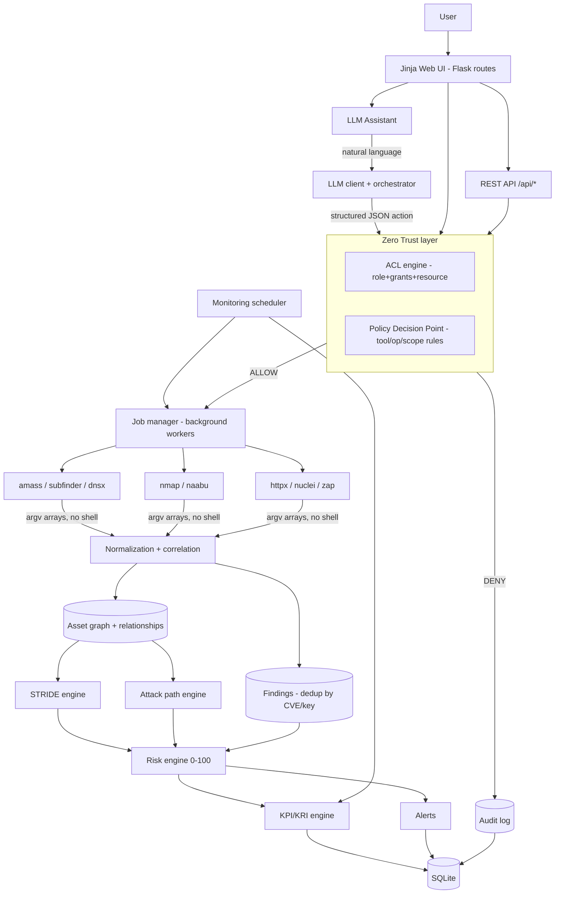

# SentinelScope ASM — Complete Documentation

**Web-Based Attack Surface Management (ASM) & Security Risk Management Platform**
*For authorized organizational security assessment only.*

> Companion docs: `README.md` (overview & install), `docs/` (deep dives: database, API,
> policy, LLM, threat modeling, risk, metrics). This document is the full user & reference guide.

---

## Table of Contents

1. [What This Tool Is](#1-what-this-tool-is)
2. [How The Whole System Works](#2-how-the-whole-system-works)
3. [Quick Start — Running The Tool](#3-quick-start--running-the-tool)
4. [Accounts, Roles & Permissions](#4-accounts-roles--permissions)
5. [Complete UI Walkthrough](#5-complete-ui-walkthrough)
6. [Complete Endpoint Reference](#6-complete-endpoint-reference)
7. [The Scan Workflow & Validation Chain](#7-the-scan-workflow--validation-chain)
8. [Policy System](#8-policy-system)
9. [STRIDE Threat Modeling](#9-stride-threat-modeling)
10. [Risk Scoring](#10-risk-scoring)
11. [KPI / KRI Metrics](#11-kpi--kri-metrics)
12. [Continuous Monitoring](#12-continuous-monitoring)
13. [LLM Assistant](#13-llm-assistant)
14. [Reports & Exports](#14-reports--exports)
15. [Demo Data](#15-demo-data)
16. [Configuration Reference](#16-configuration-reference)
17. [Troubleshooting](#17-troubleshooting)
18. [Security Notes](#18-security-notes)

---

## 1. What This Tool Is

Organizations use many separate security tools (Amass, Subfinder, Nmap, Nuclei, httpx, …)
that each produce disconnected outputs. **SentinelScope ASM is the central orchestration,
correlation, analysis, policy and risk layer** on top of them:

```
Multiple security tools
        ↓ raw results
Normalization
        ↓
Asset correlation (asset graph)
        ↓
STRIDE threat modeling
        ↓
Holistic risk scoring (explainable, 0–100)
        ↓
KPI / KRI metrics
        ↓
Dashboards · Alerts · Reports
   — all gated by organization policy + ACL (Zero Trust)
```

It is **not** a "enter domain → run nmap → show output" scanner dashboard. No scanner
process ever starts before passing: **schema validation → ACL → scope → policy → approval**,
and every allow/deny decision is written to an audit log.

Key properties:

- **Zero Trust enforcement** — role alone is never enough; resource + organization checks apply.
- **Policy-driven** — a human-readable Markdown policy defines scope, tools, operations.
- **LLM as orchestrator only** — the assistant proposes structured actions; the backend
  enforces them. The LLM can never bypass policy, run commands, or invent results.
- **Deterministic risk** — scoring is a pure backend function with a transparent breakdown.
- **Organization-scoped** — strict tenant isolation; users only ever see their own org's data.

---

## 2. How The Whole System Works

### Architecture



### The data pipeline (what happens on a scan)

1. **Request** — a user (or the LLM, or a monitoring schedule) requests an operation
   (e.g. `port_scan`) on a target (e.g. `api.example.com`).
2. **Validation chain** (see §7) — ACL, then the Policy Decision Point. Denied requests
   are audited and nothing executes.
3. **Queuing** — a `ScanJob` row is created (`queued`); background worker threads pick it
   up (`running`) so HTTP requests never block on slow scans.
4. **Execution** — the tool adapter builds an **argument array** (never a shell string)
   and runs it with `subprocess.run(..., shell=False)`.
5. **Normalization** — the adapter parses raw output into normalized records.
6. **Correlation** — records become graph assets (`domain → subdomain → ip → port →
   webapp → technology`), linked with typed relationships. Vulnerability records become
   findings deduplicated across tools by CVE/dedup-key (Nuclei + OpenVAS on the same CVE
   = one issue). New/changed assets also produce **change events**.
7. **Analysis** — you (or a monitoring cycle) then run the STRIDE engine, attack-path
   engine, and risk engine, which populate threats, potential paths, and scores.
8. **Metrics** — KPIs/KRIs are calculated and snapshotted over time; alerts are raised.

### Background workers

Two worker threads run inside the web process. They poll the `scan_jobs` table, so the
web UI stays responsive. Jobs can be cancelled cooperatively. Stale `running` jobs left
by a restart are marked failed at startup.

### Database

SQLite at `instance/asm.db` (24 tables, WAL mode, FK enforcement). All org-scoped tables
carry `organization_id`. Full schema: `docs/DATABASE.md`.

---

## 3. Quick Start — Running The Tool

### First run

```bash
cd /mnt/hgfs/kali_linux_share/ASM

# 1. (optional but recommended) python virtual environment
python3 -m venv .venv && source .venv/bin/activate
pip install -r requirements.txt

# 2. configure — at minimum set SECRET_KEY; LLM settings for the assistant
cp .env.example .env
nano .env          # see §16

# 3. create the database + synthetic demo data (recommended first run)
python3 run.py --demo
#    → prints a generated admin password ONCE — save it!

# 4. start the web app
python3 run.py                        # http://127.0.0.1:5000
python3 run.py --host 0.0.0.0 --port 5000   # reachable from your LAN
```

### All command-line options

| Command | What it does |
|---|---|
| `python3 run.py` | start the web server (default `127.0.0.1:5000`) |
| `python3 run.py --host 0.0.0.0 --port 5000` | bind address/port |
| `python3 run.py --init-db` | create tables + seed roles + generate admin (no demo data) |
| `python3 run.py --demo` | init DB **and** load the synthetic demo dataset |
| `python3 run.py --test-llm` | test the configured LLM connection and exit |

### Verify it is working

1. Open `http://<host>:5000` → login page.
2. Log in (accounts below) → **Dashboard** shows assets, findings, risk score.
3. **Scans → Tool Status** shows which external tools are installed.
4. **Settings → Test connection** (admin) verifies the LLM.

### Running it persistently (production-ish)

The built-in server is Flask's dev server — fine for testing. For persistent/serious use:

```bash
# simple detach (survives terminal close)
setsid nohup python3 run.py --host 0.0.0.0 --port 5000 > /tmp/asm.log 2>&1 < /dev/null &

# production: WSGI server + no debugger
APP_ENV=production pip install waitress
waitress-serve --host 0.0.0.0 --port 5000 run:app   # (add app = create_app() to run.py)
```

**Keep `APP_ENV=development`'s debugger away from untrusted networks.** For real
organizational use: production WSGI server, HTTPS reverse proxy, `SESSION_COOKIE_SECURE=1`.

---

## 4. Accounts, Roles & Permissions

### Built-in accounts

| Account | Role | Password | Notes |
|---|---|---|---|
| `admin` | **Platform Administrator** | generated at first init (in `you_must_remember.md` for the demo DB) | manages users/orgs/settings; no org-scoped scan powers by itself |
| `demo_analyst` | Organization **Analyst** (Demo Org) | `DemoPass123!` | full operational role inside the org |
| `demo_author` | Organization **Author** (Demo Org) | `DemoPass123!` | writes/publishes policy; **cannot** run scans |
| `demo_admin` | Organization **Admin** (Demo Org) | `DemoPass123!` | org-level admin incl. risk config, monitoring |

Demo accounts exist only after `python3 run.py --demo`. Change them before real use
(Admin → Users → reset password).

### Role permission matrix

| Permission | Platform Admin | Org Admin | Author | Analyst |
|---|:-:|:-:|:-:|:-:|
| user create/update/delete/view | ✓ | — | — | — |
| organization create/update/view | ✓ | — | — | — |
| settings view/manage (LLM test) | ✓ | — | — | — |
| audit view | ✓ | ✓ | ✓ | — |
| asset view | read* | ✓ | ✓ | ✓ |
| asset create/update | read* | ✓ | — | ✓ |
| asset delete | read* | ✓ | — | — |
| scan view / create / cancel | read* | ✓ | view only | ✓ |
| vulnerability view / update | read* | ✓ | view only | ✓ |
| stride view / create / update | read* | ✓ | view only | ✓ |
| trust boundary view / manage | read* | ✓ | view only | ✓ |
| attack path view | read* | ✓ | ✓ | ✓ |
| risk view / configure | read* | ✓ | view only | view only |
| report view / create / export | read* | ✓ | ✓ | ✓ |
| policy view / test | — | view only | ✓ full | view only |
| policy publish | — | — | ✓ | — |
| llm use / execute | — | ✓ | use only | ✓ |
| kpi / kri view | — | ✓ | ✓ | ✓ |
| monitoring view / manage | — | ✓ | view only | ✓ |
| alert view / update | — | ✓ | view only | ✓ |
| tool view | ✓ | ✓ | ✓ | ✓ |

\* Platform admins get **read visibility** inside an org only if they are also a member;
administration pages (users/orgs/settings) work without any membership.

**Layered on top of roles:** each membership can carry extra grants
(`extra_permissions`, e.g. give an author `scan:create`), and every resource is
organization-checked (a foreign org's asset ID returns **404**, never 403 — no
existence oracle).

---

## 5. Complete UI Walkthrough

After login you pick an **organization context** (all data is scoped to it — switchable
any time via “Switch org”).

| Page (sidebar) | URL | What you do there |
|---|---|---|
| **My Profile** | `/profile/` | update your own email or password; username, roles, memberships, and platform status are administrator-managed |
| **Dashboard** | `/` | org overview: asset/finding counts, org risk score, findings-by-severity bars, highest-risk assets, recent changes, recent alerts |
| **All Assets** | `/assets/` | searchable/filterable inventory (group, text, risk level, owner, tag); pagination |
| **Asset detail** | `/assets/<id>` | the heart of the tool: risk score **+ “why is this scored N?”**, criticality/exposure/environment, relationships (graph edges), open vulnerabilities, STRIDE threats, change history, audit history, and edit/delete forms |
| **Add Asset** | `/assets/new` | manually register an asset — network-identifiable names are **validated against policy scope** |
| **New Scan** | `/scans/new` | pick operation + target; shows a live **validation preview** (ACL verdict, policy checks ✓/✗) before launching; approval checkbox for intrusive ops |
| **Scan Jobs** | `/scans/` | every job with status (`queued/running/completed/failed/cancelled`), filterable |
| **Job detail** | `/scans/<id>` | tool version, parameters, duration, **full validation trail**, result summary, findings produced, cancel button |
| **Tool Status** | `/scans/tools` | which external tools are installed, versions, paths + install hints |
| **Vulnerabilities** | `/vulnerabilities/` | all findings, filterable by severity/status/source/text; CSV export |
| **Finding detail** | `/vulnerabilities/<id>` | evidence, remediation, dedup key, **correlated sources** (same issue from multiple tools), status workflow |
| **STRIDE Threats** | `/stride/` | per-category counts, recent threats, trust boundaries; **Run STRIDE engine** button |
| **Threat detail** | `/stride/threat/<id>` | evidence list, confidence, severity, mitigation, status workflow (potential→confirmed/mitigated) |
| **Trust Boundaries** | `/stride/boundaries` | create/delete boundaries, place assets inside/outside |
| **Attack Paths** | `/risk/paths` | inferred **Potential Attack Paths** with scores; detail view shows step-by-step hops with reasons |
| **Risk** | `/risk/` | org score, score trend chart, asset risk distribution, risk-by-environment, top assets, top paths; **recalculate + adjust component weights** (admin) |
| **KPI** | `/metrics/kpi` | 7 performance indicators, each with its formula and inputs |
| **KRI** | `/metrics/kri` | 10 risk indicators + STRIDE distribution + trend charts |
| **Monitoring** | `/monitoring/` | schedules (create/enable/run-now), alerts (acknowledge), change timeline + change-type summary |
| **Policies** | `/policies/` | active policy, **full version history**, states |
| **Policy builder** | `/policies/builder` | form-first authoring; generates canonical Markdown, validates, and saves a new version |
| **Policy editor** | `/policies/edit` | advanced Markdown editor → save & validate (errors keep it a draft) |
| **Policy version** | `/policies/version/<id>` | content + parsed representation + publish/rollback buttons |
| **Policy Test** | `/policies/test` | dry-run any target/tool/operation against the active policy — shows **ALLOW/DENY with reasons** (nothing executes) |
| **LLM Assistant** | `/assistant/` | chat; operational requests become validated structured actions with per-action decision trail |
| **Reports** | `/reports/` | executive / technical / policy-audit reports; CSV exports |
| **Audit Logs** | `/audit/` | every decision and action (user, action, resource, result, reason, IP) |
| **Settings** | `/admin/settings` | LLM connection status + **Test connection**; external tool status |
| **Users & Memberships** | `/admin/users` | create/edit users, change email/username/platform-admin state, reset passwords, enable/disable, add/remove organization memberships, assign roles and extra permissions, delete accounts with safety guards |
| **Organizations** | `/admin/organizations` | create/edit organizations; delete with exact-name confirmation and tenant-data cascade safeguards |

---

## 6. Complete Endpoint Reference

All UI endpoints are session-authenticated; API endpoints too (cookie session — send the
`X-CSRF-Token` header with JSON POSTs; get the token from any page's `_csrf_token`).

### Authentication

| Method | Endpoint | Description |
|---|---|---|
| GET/POST | `/auth/login` | login (CSRF-protected, throttled: 5 fails → 5 min lockout) |
| POST | `/auth/logout` | logout |
| GET/POST | `/auth/select-org` | choose/switch organization context |

### Assets

| Method | Endpoint | Permission | Description |
|---|---|---|---|
| GET | `/assets/` | asset:view | inventory with filters (`?group=&q=&severity=&owner=&tag=`) |
| GET | `/assets/<id>` | asset:view | full asset detail |
| GET/POST | `/assets/new` | asset:create | add asset (scope-validated) |
| POST | `/assets/<id>/edit` | asset:update | update criticality/exposure/owner/status |
| POST | `/assets/<id>/delete` | asset:delete | delete asset + linked records |
| GET | `/assets/graph` | asset:view | JSON nodes/edges for the relationship graph |

### Scans

| Method | Endpoint | Permission | Description |
|---|---|---|---|
| GET | `/scans/` | scan:view | job list (filter `?status=`) |
| GET/POST | `/scans/new` | scan:create | launch form + validation preview |
| GET | `/scans/<id>` | scan:view | job detail + validation trail + findings |
| POST | `/scans/<id>/cancel` | scan:cancel | cancel queued/running job |
| GET | `/scans/api/status/<id>` | scan:view | job status JSON (for polling) |
| GET | `/scans/tools` | tool:view | external tool availability table |

### Vulnerabilities

| Method | Endpoint | Permission | Description |
|---|---|---|---|
| GET | `/vulnerabilities/` | vulnerability:view | findings (filters `?severity=&status=&source=&q=`) |
| GET | `/vulnerabilities/<id>` | vulnerability:view | finding detail + correlated sources |
| POST | `/vulnerabilities/<id>/status` | vulnerability:update | change status (open/in_progress/resolved/risk_accepted/false_positive) |

### STRIDE & trust boundaries

| Method | Endpoint | Permission | Description |
|---|---|---|---|
| GET | `/stride/` | stride:view | dashboard: category counts, threats, boundaries |
| POST | `/stride/generate` | stride:create | run the STRIDE engine on all assets |
| GET | `/stride/threat/<id>` | stride:view | threat detail |
| POST | `/stride/threat/<id>/status` | stride:update | update threat status |
| GET/POST | `/stride/boundaries` | trust_boundary:view (+manage for changes) | manage boundaries & members |

### Risk & attack paths

| Method | Endpoint | Permission | Description |
|---|---|---|---|
| GET | `/risk/` | risk:view | org score, distribution, trend, top assets/paths |
| POST | `/risk/recalculate` | risk:configure | recalculate; optional custom component weights |
| GET | `/risk/paths` | attack_path:view | attack path list |
| GET | `/risk/paths/<id>` | attack_path:view | path steps with per-hop reasons |

### Metrics

| Method | Endpoint | Permission | Description |
|---|---|---|---|
| GET | `/metrics/kpi` | kpi:view | KPI dashboard |
| GET | `/metrics/kri` | kri:view | KRI dashboard |
| POST | `/metrics/snapshot` | monitoring:manage | record a KPI/KRI/org-score snapshot now |

### Monitoring & alerts

| Method | Endpoint | Permission | Description |
|---|---|---|---|
| GET | `/monitoring/` | monitoring:view | schedules, alerts, change timeline |
| POST | `/monitoring/schedules/new` | monitoring:manage | create schedule |
| POST | `/monitoring/schedules/<id>/toggle` | monitoring:manage | enable/disable |
| POST | `/monitoring/schedules/<id>/run` | monitoring:manage | run a monitoring cycle now |
| POST | `/monitoring/alerts/<id>/ack` | alert:update | acknowledge alert |

### Policies

| Method | Endpoint | Permission | Description |
|---|---|---|---|
| GET | `/policies/` | policy:view | active policy + version history |
| GET/POST | `/policies/builder` | policy:update | form-first builder; generated Markdown, preview, validation, and new version |
| GET/POST | `/policies/edit` | policy:update | advanced Markdown editor; save & validate → new draft/validated version |
| GET | `/policies/version/<id>` | policy:view | content + parsed representation |
| POST | `/policies/version/<id>/publish` | policy:publish | publish (archives previous active) |
| POST | `/policies/version/<id>/rollback` | policy:publish | republish an archived version |
| GET/POST | `/policies/test` | policy:test | dry-run a proposed action against policy |

### LLM assistant

| Method | Endpoint | Permission | Description |
|---|---|---|---|
| GET | `/assistant/` | llm:use | chat UI + request history |
| POST | `/assistant/chat` | llm:use | send a message; returns intent + per-action decisions |
| POST | `/assistant/action/<id>/approve` | llm:execute | approve a pending-approval action (re-validated) |

### Reports

| Method | Endpoint | Permission | Description |
|---|---|---|---|
| GET | `/reports/` | report:view | report hub |
| GET | `/reports/executive` | report:view | executive report |
| GET | `/reports/technical` | report:view | technical report |
| GET | `/reports/policy-audit` | report:view | policy versions + decisions + LLM actions |
| GET | `/reports/export/findings.csv` | report:export | findings CSV |
| GET | `/reports/export/assets.csv` | report:export | assets CSV |

### Administration

| Method | Endpoint | Permission | Description |
|---|---|---|---|
| GET | `/admin/users` | user:view | user management |
| POST | `/admin/users/new` | user:create | create user (password policy enforced) |
| POST | `/admin/users/<id>/update` | user:update | edit profile, platform-admin state, enable/disable, reset password, memberships, roles, validated extra permissions |
| POST | `/admin/users/<id>/delete` | user:delete | delete account while preserving historical attribution; self/last-admin protected |
| GET | `/admin/organizations` | organization:view | organization list |
| POST | `/admin/organizations/new` | organization:create | create organization |
| POST | `/admin/organizations/<id>/update` | organization:update | edit name and description |
| POST | `/admin/organizations/<id>/delete` | organization:update | permanently delete tenant data after exact-name confirmation |
| GET | `/admin/settings` | settings:view | LLM status + tool status |
| POST | `/admin/settings/llm-test` | settings:manage | live LLM connection test |

### Audit

| Method | Endpoint | Permission | Description |
|---|---|---|---|
| GET | `/audit/` | audit:view | audit log (filters `?result=&action=`) |

### REST API (JSON)

| Method | Endpoint | Permission | Description |
|---|---|---|---|
| GET | `/api/assets` | asset:view | assets (`?q=&type=&limit=`) |
| GET | `/api/assets/<id>` | asset:view | asset detail JSON |
| GET | `/api/findings` | vulnerability:view | open findings (`?severity=&limit=`) |
| GET | `/api/stride` | stride:view | threats JSON |
| GET | `/api/risk` | risk:view | org score + per-asset scores |
| GET | `/api/kpi` | kpi:view | all KPIs |
| GET | `/api/kri` | kri:view | all KRIs |
| GET | `/api/policies` | policy:view | policy versions + active |
| POST | `/api/policies/validate` | policy:view | body `{"content": "…md…"}` → validation errors |
| POST | `/api/policies/publish` | policy:publish | body `{"version_id": n}` → publish |
| POST | `/api/scans` | scan:create | body `{"tool","operation","targets","parameters"}` → 201 job, or 403 with the denial layer + policy trail |
| GET | `/api/audit` | audit:view | audit entries (`?limit=`) |

API example (denied):

```bash
curl -b cookies.txt -X POST http://localhost:5000/api/scans \
  -H 'Content-Type: application/json' -H "X-CSRF-Token: $TOKEN" \
  -d '{"tool":"nmap","operation":"port_scan","targets":["198.51.100.80"]}'
# 403 {"decision":"denied","layer":"policy","policy":{...✓/✗ checks...}}
```

---

## 7. The Scan Workflow & Validation Chain

Every scanner action — manual form, REST API, LLM proposal, or monitoring schedule —
passes the **same** chain, in order:

```
1. Schema validation      known operation? targets present? (LLM tool name is advisory —
                          the backend maps operation→tool, so a tampered tool field is ignored)
2. ACL                    does the user hold the permission in this org context?
3. Scope                  every target inside the published policy's domains/CIDRs?
4. Policy                 tool allowed? operation allowed? not restricted? severity rules?
5. Active-scan warning    active/intrusive op on production → show an active-interaction
                          warning and require explicit confirmation (manual: checkbox;
                          LLM: pending → approve → RE-VALIDATED at approval time)
6. Execution              queued as a job → worker → subprocess argv (no shell) → results
```

Failures at any layer produce a **clear reason + audit entry**, and no process starts.

**Operations available:** `subdomain_discovery` (subfinder/amass), `dns_enumeration`
(dnsx), `port_scan` (nmap/naabu), `service_detection` (nmap -sV), `web_probe` (httpx),
`vulnerability_scan` (nuclei or **zap**), `passive_recon` (amass), `tech_detection` (httpx).

For ZAP: install `sudo apt update && sudo apt install -y zaproxy`, verify
`/usr/share/zaproxy/zap.sh -version`, then use **New Scan → vulnerability_scan → zap**.
The adapter writes a structured JSON report, maps ZAP alerts to normalized findings, and
runs the normal correlation, STRIDE, risk, KPI/KRI and report pipeline. It accepts only
absolute `http://` or `https://` targets and remains subject to scope and active-scan
approval rules.

**Example — why was my scan denied?**

```
Requested: nmap port_scan 198.51.100.80
Decision:  DENY
✓ Tool 'nmap' is in the allowed tools list
✓ Operation 'port_scan' is an allowed operation
✗ Target(s) outside authorized scope: 198.51.100.80
```

---

## 8. Policy System

The Organization Author writes a Markdown policy (example bundled at
`policies/organization_policy.md`). Structure:

```markdown
# Organization Security Policy
## Organization
Name: Example Organization
## Authorized Scope
### Domains          # exact + *.wildcard domains
- example.com
- *.example.com
### IP Ranges        # IPv4 CIDRs
- 203.0.113.0/24
## Allowed Tools     # from: amass subfinder dnsx nmap naabu httpx nuclei zap openvas
- nmap
## Allowed Operations
- port_scan
## Restricted Operations
- brute_force
## Production Rules
- Production assets require non-intrusive scans only.
## Vulnerability Scanning
- Allowed severities: low, medium, high, critical
## LLM Rules
- LLM must never bypass ACL.
## Data Access
- Sensitive credentials must never be exposed through the LLM.
```

- **Saving** validates (missing sections, bad domains/CIDRs, unknown tools/ops → errors;
  errors keep the version a **draft**).
- **Lifecycle:** `draft → validated → published → archived`. Only the **published**
  version controls execution. With none published, everything is denied (fail-closed).
- **Publishing** archives the previous active version (never silently replaced);
  **rollback** republishes an older version.
- **Policy Test** (`/policies/test`) lets the author dry-run any action — perfect for
  demonstrating the Zero Trust concept.

---

## 9. STRIDE Threat Modeling

**Run it:** STRIDE → “Run STRIDE engine on all assets” (or it runs during monitoring
cycles / risk recalculation).

The engine evaluates each asset's type, exposure, name indicators, technologies,
services, open findings, and trust-boundary position, then emits threats with:

- **Category** — S(teroid)/T/ampering, R/epudiation, I/nformation Disclosure,
  D/enial of Service, E/levation of Privilege (plus S/poofing)
- **Evidence** — the concrete data points that triggered the rule
- **Severity + Confidence** — how bad, how sure
- **Status** — `potential → observed / confirmed / needs_review / mitigated` (humans
  confirm; the engine never claims “confirmed” by itself)
- **Mitigation** — suggested fix
- **Fingerprint** — re-runs update in place instead of duplicating

Current rules include: exposed asset + high findings → Information Disclosure;
admin-named internet asset → Elevation of Privilege; plaintext HTTP webapp → Spoofing;
CVE findings → Elevation of Privilege; cross-boundary flows without audit evidence →
Repudiation; exposed service → Denial of Service. Full model: `docs/THREAT-MODELING.md`.

**Trust boundaries** (STRIDE → Trust Boundaries) let you model zones — e.g. place
`api.example.com` *outside* the “Internet → Web Application” boundary and *inside*
“Web Application → Internal API”.

---

## 10. Risk Scoring

Per-asset holistic score, 0–100, deterministic and fully explainable:

| Component | Default weight | Driven by |
|---|---|---|
| vulnerability | 25 | open findings (severity mix + count) |
| exposure | 18 | internet / restricted / internal |
| criticality | 18 | asset importance (user-set) |
| exploitability | 12 | CVE findings, easily-exploited classes (rce/injection/auth bypass) |
| stride | 12 | open STRIDE threats |
| attack_path | 10 | presence in inferred attack paths |
| configuration | 5 | plaintext HTTP, exposed admin, brand-new assets |

**Org score** = 0.6 × mean(asset scores) + 0.4 × worst asset.

- Every calculation stores its full factor breakdown + weights and renders an
  explanation on the asset page (“Why is this asset scored 74?”).
- Org Admins can change weights at Risk → Recalculate; every stored score keeps the
  weights used.
- **The LLM never computes or alters scores.**

**Attack paths:** graph walks (BFS, depth ≤ 6, max 50 paths) from internet-exposed entry
points to high-value targets (admin indicators, high criticality, risk ≥ 60, high
findings). Path score = 20 + exposure/admin/findings bonuses. Always labeled
**Potential Attack Path**. Details: `docs/RISK.md`.

---

## 11. KPI / KRI Metrics

**KPIs** (performance) — `/metrics/kpi`:

| KPI | Formula |
|---|---|
| Asset Discovery Coverage | discovered / expected × 100 (expected = 20 × scope domains) |
| Scan Completion Rate | completed / finished × 100 |
| Vulnerability Remediation Rate | closed / total × 100 |
| Mean Time To Remediation | mean(resolved_at − first_seen) in hours |
| Asset Classification Coverage | (has criticality AND owner) / total × 100 |
| Policy Compliance Rate | compliant / total scan+LLM actions × 100 (30 days) |
| Scan Success Rate | successful / (successful + failed) × 100 |

**KRIs** (risk exposure) — `/metrics/kri`:

| KRI | Formula |
|---|---|
| Critical Internet-Facing Assets | count(internet AND criticality ∈ {high, critical}) |
| Critical Vulnerability Exposure | count(open critical findings on internet assets) |
| High-Risk Asset Percentage | count(score ≥ 70) / total × 100 |
| Attack Surface Growth | (new − removed) / current × 100 (30 days) |
| Newly Exposed Assets | new internet-facing in 7 days |
| Unmanaged Assets | no owner or no criticality |
| STRIDE Risk Distribution | threats per category |
| High-Risk Attack Paths | paths with score ≥ 70 |
| Policy Violations | denied decisions in 30 days |
| Open High-Severity CVEs | open findings with CVE, severity high/critical |

Snapshots are recorded on recalculation/monitoring cycles and power trend charts.

---

## 12. Continuous Monitoring

**Schedules** (Monitoring → create): `hourly / 6h / 12h / daily / weekly`. A scheduler
thread checks due schedules every 30 s. A cycle:

```
discovery (policy-validated, same chain as manual scans)
  → correlation → change detection (new/removed assets, ports, services, findings…)
  → analysis engines → KPI/KRI snapshots → alerts
```

Every change lands in the **change timeline** (`change_events`), e.g.
“203.0.113.20: New Port: 8080”. **Alerts** are raised for new critical findings and
assets scoring ≥ 85 (deduplicated per day), shown on the dashboard, and acknowledged
in the UI. Schedules ship disabled-by-default toggle and a “Run now” button.

---

## 13. LLM Assistant

Configure in `.env` (any OpenAI-compatible endpoint):

```env
LLM_BASE_URL=https://api.example.com/v1
LLM_API_KEY=your_token
LLM_MODEL=your-model
```

Test anytime: Settings → **Test connection**, or `python3 run.py --test-llm`.
The key lives only in the environment — never in the DB, UI, or API responses.

**What it can do** (`/assistant/`):

- Answer questions using live platform data: *“Show me the highest-risk internet-facing
  assets.”* / *“Why is api.example.com high risk?”* / *“Which assets have Information
  Disclosure threats?”*
- Turn operational requests into **structured action plans**:
  *“Run a non-intrusive vulnerability scan on new high-risk web assets.”* → JSON →
  validation chain → queued job (with approval if policy requires) → job link in chat.

**Hard security rules** (system prompt + backend):

- External/scan data is **untrusted** — instructions inside results are never followed.
- Cannot modify policy, bypass ACL, expand scope, cross organizations, invent results,
  or run shell commands.
- Its suggested tool name is advisory — the backend maps operation → tool.
- Approval-gated actions are **re-validated at approval time** (a policy change between
  proposal and approval cannot be exploited).

Every request/proposal/decision is persisted and visible in the Policy Audit report.

---

## 14. Reports & Exports

| Report | Contents |
|---|---|
| **Executive** | org risk score, critical findings, KPI/KRI tables, STRIDE overview, top attack paths, major changes |
| **Technical** | full asset inventory, open findings with evidence, STRIDE threats, sample risk calculations |
| **Policy Audit** | policy version history, all allow/deny decisions, LLM actions with backend validation outcomes |

Exports (Reports → Exports or the buttons on lists): **findings CSV**, **assets CSV**.
HTML reports print to PDF from the browser. All exports are permission-checked
(`report:export`) and audited.

---

## 15. Demo Data

`python3 run.py --demo` loads a **clearly synthetic** dataset (nothing real is scanned):

- Demo Organization + demo policy (published v4 with scope `example.com`,
  `*.example.com`, `203.0.113.0/24`, `192.168.245.0/24`)
- Assets: example.com hierarchy (api/admin/vpn/www/staging subdomains, IPs, ports,
  webapps, technologies) with full relationships
- Findings incl. **Log4Shell correlated across Nuclei + OpenVAS**, an exposed admin
  panel, plaintext HTTP, outdated OpenSSH, missing headers, weak TLS
- STRIDE threats, potential attack paths, risk scores + explanations
- Change events, an alert, a (disabled) monitoring schedule
- 5 org-risk snapshots so trend charts have data

Demo users: `demo_analyst` / `demo_author` / `demo_admin` — password `DemoPass123!`.

---

## 16. Configuration Reference

`.env` (copy from `.env.example`; never commit):

| Variable | Purpose |
|---|---|
| `SECRET_KEY` | session signing — set a long random string |
| `DATABASE_URL` | default `sqlite:///asm.db` (→ `instance/asm.db`). **On a VMware/VirtualBox shared folder, override with a local-disk path** — e.g. `sqlite:////home/kali/asm_data/asm.db` (see troubleshooting) |
| `LLM_BASE_URL` | OpenAI-compatible endpoint, e.g. `https://api.x.com/v1` |
| `LLM_API_KEY` | token — kept out of DB/UI/logs |
| `LLM_MODEL` | model name |
| `LLM_TEMPERATURE` / `LLM_MAX_TOKENS` / `LLM_TIMEOUT` | generation controls |
| `APP_ENV` | `development` (debug on) / `production` (debug off) |
| `LOG_LEVEL` | logging verbosity |
| `JOB_WORKERS` | background scan workers (default 2) |
| `SESSION_COOKIE_SECURE` | `1` when serving over HTTPS |

External tools are detected at runtime (nmap/amass/httpx/nuclei are apt/go installs —
hints on the Tool Status page). On Kali, install `httpx-toolkit`: the ASM logical name
remains `httpx`, but the detected executable is `/usr/bin/httpx-toolkit` (or set
`HTTPX_BINARY`). Missing tools never fail silently: jobs fail with a clear error and the
UI shows availability. Tool Status caches version probes for 5 minutes and runs uncached
probes are only run when requested (the page default shows availability/path instantly), so the page stays responsive even when one tool is slow. Use the Refresh versions button for detailed version probes.

---

## 17. Troubleshooting

| Symptom | Cause / Fix |
|---|---|
| Login rejected for `admin` | password is generated per init — see `you_must_remember.md` for the demo DB, or reset: run a Python shell with `user.set_password("NewPass123!")` |
| Every scan denied: “No published organization policy” | publish a policy (Policies → Edit → save → Publish) |
| Scan denied: “outside authorized scope” | add the target to `## Authorized Scope` and publish a new version |
| “Policy requires explicit approval…” | active/intrusive ops need the approval checkbox (manual) or the Approve button (LLM actions) |
| Job shows `failed: tool … is not installed` | install the tool (Tool Status page lists hints) — missing tools never run silently |
| LLM answers “not configured” | set `LLM_BASE_URL/LLM_API_KEY/LLM_MODEL` in `.env` and restart |
| LLM test: “returned empty content” | transient model behavior — the test retries once; check the model name |
| `database is locked` (recurring) | **SQLite cannot lock reliably on VMware hgfs/VirtualBox shared folders** — WAL does not help there. Fix: keep the DB on local disk and point `DATABASE_URL` at it (this project uses `sqlite:////home/kali/asm_data/asm.db`). The code, templates and `.env` can stay on the share |
| Forgot admin password entirely | `rm instance/asm.db*` and re-run `--demo` (demo data only!) |
| Pages show a Flask debugger | you're in `APP_ENV=development` — expected; don't expose it to untrusted networks |

Useful checks:

```bash
python3 -m pytest tests/ -q          # 45 tests — full regression
python3 run.py --test-llm            # LLM connectivity
python3 -m pyflakes app/ | grep "undefined name"   # static sanity (should be empty)
curl http://localhost:5000/scans/api/status/<job_id>   # poll a job
```

---

## 18. Security Notes

- **Platform defenses:** parameterized ORM (SQLi), argv-array subprocess + target
  validation (command injection), Jinja auto-escaping (XSS), CSRF tokens on every
  state-changing request, session-fixation defense, login throttling, password policy,
  IDOR defense via org-scoped resource checks (404, not 403), no file-upload surface,
  secrets never in DB/templates/logs, scan output rendered as escaped text.
- **Authorization is layered:** role → membership → resource → policy → approval.
  The LLM sits *inside* the same chain as everyone else.
- **Before real organizational use:** production WSGI server, HTTPS +
  `SESSION_COOKIE_SECURE=1`, change all demo passwords, review the policy scope,
  and point scanners only at assets you are authorized to assess.

---

*Generated from a full-project scan on 2026-10-01: 60 endpoints, 24 tables, 45 tests
passing, 9 tool adapters (nmap/amass/httpx/nuclei verified installed). Database lives on
local disk (`/home/kali/asm_data/asm.db`) because SQLite locking fails on hgfs shares —
code stays on the share.*
