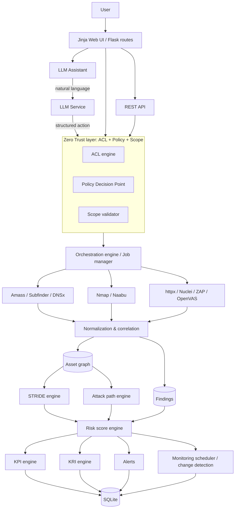

# SentinelScope ASM — Web-Based Attack Surface Management & Security Risk Management Platform

A real, working Flask application for **authorized organizational security assessment**. It
continuously discovers and monitors an organization's attack surface, integrates external
security tools, correlates their results into an asset graph, performs STRIDE threat
modeling, computes deterministic holistic risk scores and KPI/KRI metrics, enforces
organization-defined Markdown policies with Zero-Trust access control, and provides a
policy-gated LLM assistant that can orchestrate scans — never outside the enforced rules.

```
DISCOVER → UNDERSTAND → CORRELATE → THREAT MODEL → ASSESS RISK →
PRIORITIZE → CONTROL ACCESS → LLM ORCHESTRATION → TAKE ACTION → MONITOR → REPEAT
```

---

## 1. What the platform is

Organizations use many separate security tools (Amass, Subfinder, Nmap, Nuclei, httpx, …)
that produce disconnected outputs. SentinelScope ASM is the **central orchestration,
correlation, analysis, policy, risk and visualization layer** on top of them:

```
Multiple security tools → raw results → normalization → asset correlation
→ attack surface graph → STRIDE threat modeling → risk analysis → KPI/KRI
→ dashboards / alerts / reports — all gated by policy + ACL (Zero Trust)
```

It is **not** a "enter domain → run nmap → show results" scanner dashboard: every scanner
action passes through a validation chain (`schema → ACL → scope → policy → approval`)
before any process starts, and every decision is audited.

## 2. Architecture



Additional diagrams live in the `docs/` pages below (LLM architecture, threat modeling,
risk scoring, KPI/KRI formulas, policy format).

## 3. Installation

Requirements: **Python 3.11+** (developed on 3.14), pip.

```bash
cd asm-platform
python3 -m venv .venv && source .venv/bin/activate   # optional but recommended
pip install -r requirements.txt

cp .env.example .env        # then edit — see section 8/9
python run.py --demo        # create DB + load synthetic demo data (recommended first run)
python run.py               # start on http://127.0.0.1:5000
```

On first `--init-db` / `--demo` an administrator account is generated and its password is
printed **once** to the console.

Other commands:

```bash
python run.py --init-db     # create tables only (no demo data)
python run.py --test-llm    # test the configured LLM connection and exit
```

## 4. Python environment

Any Python ≥ 3.11 works. Dependencies (Flask, Flask-SQLAlchemy, Flask-Login, SQLAlchemy,
requests, python-dotenv, pytest) are pinned loosely in `requirements.txt`. No compiled
dependencies are required.

## 5. SQLite

The database lives at `instance/asm.db` by default (`DATABASE_URL=sqlite:///asm.db`).
24 tables cover users/orgs, policies, assets + relationships + tags + trust boundaries,
scan jobs, findings, STRIDE threats, risk scores, attack paths, metric snapshots,
schedules, change events, alerts, audit logs and LLM request/action records. See
`docs/DATABASE.md` for the schema. Strict tenant isolation is enforced in the ACL engine
and in every query (organization_id scoping) — even though SQLite is embedded.

## 6. External tools

The platform detects installed tools at runtime (Settings → Security Tool Status, or
`/scans/tools`). Availability/path checks are instant; version probes are cached and run
only when the **Refresh versions** button is selected. Missing tools never fail silently:
their jobs fail with a clear error and the UI shows availability.

| Tool      | Purpose                    | Install |
|-----------|----------------------------|---------|
| nmap      | port/service scan          | `apt install nmap` |
| subfinder | passive subdomain discovery| `go install github.com/projectdiscovery/subfinder/v2/cmd/subfinder@latest` |
| amass     | passive OSINT discovery    | `apt install amass` |
| dnsx      | DNS enumeration            | `go install github.com/projectdiscovery/dnsx/cmd/dnsx@latest` |
| naabu     | fast port scan             | `go install github.com/projectdiscovery/naabu/v2/cmd/naabu@latest` |
| httpx     | web probing / tech detect  | Kali: `sudo apt install httpx-toolkit` (executable `httpx-toolkit`, logical ASM name `httpx`); upstream: `go install github.com/projectdiscovery/httpx/cmd/httpx@latest` |
| nuclei    | vulnerability scan         | `go install github.com/projectdiscovery/nuclei/v2/cmd/nuclei@latest` |
| zap       | web baseline scan (optional)| `apt install zaproxy` |
| openvas   | NASL vulnerability scan (optional) | requires GVM daemon |

### ZAP installation and verification

```bash
sudo apt update
sudo apt install -y zaproxy
dpkg -L zaproxy | grep '/zap.sh$'
/usr/share/zaproxy/zap.sh -version
```

SentinelScope detects `/usr/share/zaproxy/zap.sh` automatically (or set `ZAP_BINARY` in
the environment). ZAP uses its quick baseline scanner and writes a structured JSON report;
alerts are normalized into the shared Finding model, deduplicated, and included in STRIDE,
risk, KPI/KRI and reports. Each job uses an isolated temporary ZAP home directory so
concurrent jobs do not conflict. ZAP jobs default to a 30-minute timeout (bounded
configurable timeout: 60–3600 seconds). ZAP is an active scan: it must be allowed by
policy and may require explicit approval for production assets. Use only authorized targets.

Adapters live in `app/scanners/`. Adding a tool = one adapter file + registration — no
changes to core logic.

## 7. Tool execution safety

- All commands are built as **argument arrays** executed with `shell=False` in their own
  process group; a timeout terminates the whole group.
- Targets are validated against the **published policy scope** before queueing.
- Adapter-level `validate()` rejects flag injection (e.g. a target starting with `-`).
- Every job has an ID, status lifecycle (`queued → running → completed/failed/cancelled`),
  start/end times, tool version, command metadata and captured output/errors.
- Cancellation (`scan:cancel` permission) marks the job cancelled and prevents its results
  from being ingested; a process that is already running is not interrupted.

## 8. `.env` configuration

Copy `.env.example` → `.env` and edit. Never commit `.env` (it is gitignored).

```env
SECRET_KEY=<long random string>
DATABASE_URL=sqlite:///asm.db
APP_ENV=development
LOG_LEVEL=INFO
```

## 9. LLM configuration

```env
LLM_BASE_URL=https://your-openai-compatible-endpoint/v1
LLM_API_KEY=your_token
LLM_MODEL=your-model-name
LLM_TEMPERATURE=0.2
LLM_MAX_TOKENS=1024
LLM_TIMEOUT=60
```

- OpenAI-compatible `/chat/completions`; endpoint/token/model are **never hardcoded**.
- The API key lives only in the environment: never rendered in HTML, never returned by
  the API, never stored in SQLite.
- `/admin/settings` has a connection test (admins) that shows status without secrets.
- Timeout / invalid credentials / rate limits / malformed responses are handled with
  explicit error messages; the client is isolated in `app/llm/client.py`.

## 10. Policy builder and Markdown format

The recommended workflow is **Policies → Build policy with form**. The form collects
scope, tools, operations, severities, and policy rules, then generates the canonical
Markdown artifact. The generated text is stored in the versioned database record and
validated by the same parser used by the advanced Markdown editor.

Authors can use **Advanced Markdown editor** when they need direct control over the
human-readable policy text. Structure:

```markdown
# Organization Security Policy
## Organization
Name: Example Organization
## Authorized Scope
### Domains
- example.com
- *.example.com
### IP Ranges
- 203.0.113.0/24
## Allowed Tools
- nmap
- nuclei
## Allowed Operations
- port_scan
- vulnerability_scan
- subdomain_discovery
## Restricted Operations
- brute_force
## Production Rules
- Production assets require non-intrusive scans only.
## Vulnerability Scanning
- Allowed severities: low, medium, high, critical
## LLM Rules
- LLM must never bypass ACL.
## Data Access
- Sensitive credentials must never be exposed through the LLM.
```

The parser (`app/policy/parser.py`) converts this to a structured document, validates
scope entries (hostname/CIDR), tool and operation names, and reports errors in the UI.
Versions: `draft → validated → published → archived`; **only a published version
controls execution**; publishing archives the previous active version; rollback publishes
an older version again.

## 11. Roles

| Role | Scope | Highlights |
|------|-------|-----------|
| **Administrator** (platform) | whole platform | users, organizations, settings, tool config, audit. Does *not* bypass org policy for security operations. |
| **Organization Author** | org | writes/validates/publishes/rolls back policy; **cannot** run scans |
| **Security Analyst** | org | assets, scans, findings, STRIDE, risk, KPI/KRI, LLM — every action ACL- and policy-checked |

## 12. ACL

Permissions are action-scoped (`asset:view`, `scan:create`, `policy:publish`, `llm:use`,
… — full catalog in `app/acl/__init__.py`). Role base sets + per-membership extra grants
are combined by the ACL engine, then resource-level checks confirm the target record
belongs to the user's organization. Role alone is never sufficient.

## 13. Zero Trust design

```
User → Authentication → Request/Intent → Policy Decision Point
     → ACL/RBAC/org scope → Allow / Deny / Require approval
     → Policy Enforcement Point → backend resource/tool
```

- **PDP**: `app/policy/engine.py` (scope/tool/operation rules) + `app/acl/engine.py`.
- **PEP**: route decorators (`require_perm`) and the scan/orchestration services.
- Every allow/deny is written to the audit log with a reason.

## 14. STRIDE engine

`app/stride/engine.py` generates threats from asset type, exposure, technologies,
services, open findings and trust-boundary position. Each threat has: category
(S/T/R/I/D/E), affected asset, description, **evidence list**, severity, **confidence**,
status (`potential/observed/confirmed/needs_review/mitigated`), suggested mitigation.
Threats are fingerprinted so engine re-runs update in place instead of duplicating.
The engine never claims a threat is confirmed without human review.

## 15. Risk scoring

Deterministic, explainable 0–100 per asset (see `docs/RISK.md` for the model and
worked example):

| Component | Default weight |
|-----------|----------------|
| vulnerability (open findings severity mix) | 25 |
| exposure (internet/restricted/internal) | 18 |
| criticality (asset importance) | 18 |
| exploitability (CVEs, easily-exploited classes) | 12 |
| STRIDE (open threat severity mix) | 12 |
| attack path (graph position) | 10 |
| configuration (TLS, exposed admin, newness) | 5 |

Every issued point is stored per asset (`RiskScore.factors`), the explanation is rendered
on the asset page, and the weights are configurable (Risk → Recalculate). The LLM never
sets or modifies scores.

## 16. KPI

`app/metrics/kpi.py` — asset discovery coverage, scan completion rate, vulnerability
remediation rate, mean time to remediation, asset classification coverage, policy
compliance rate, scan success rate. All formulas are transparent and shown on the
dashboard (see `docs/METRICS.md`).

## 17. KRI

`app/metrics/kri.py` — critical internet-facing assets, critical vulnerability exposure,
high-risk asset %, attack surface growth, newly exposed assets, unmanaged assets, STRIDE
distribution, high-risk attack paths, policy violations, open high-severity CVEs.

## 18. Monitoring

Schedules (`hourly/6h/12h/daily/weekly`) run monitoring cycles via a background
scheduler thread: discovery → correlation → change detection → risk/threat/path
recalculation → KPI/KRI snapshots → alerts. All changes (new/removed assets, new/closed
ports, changed services, new/resolved findings, …) are recorded in a change timeline.

## 19. LLM orchestration

The assistant (`/assistant`) interprets intent and returns **structured JSON action
plans**. Each proposed action passes the full backend chain:

```
schema validation → ACL → scope → policy → approval gate → execution
```

- The LLM's tool name is advisory; the backend maps operation → tool.
- Pending-approval actions are surfaced in the UI and re-validated on approval.
- The system prompt marks all external data as untrusted (prompt-injection defense);
  `sanitize_untrusted()` treats scan content as data.
- Refusals: the LLM must refuse policy bypass requests, and even a compliant-looking
  action is re-checked by the backend — the LLM is never the security boundary.

## 20. Security considerations

OWASP-aligned protections in the platform itself: parameterized ORM queries (SQLi),
argument-array subprocess (command injection), Jinja auto-escaping (XSS), session CSRF
tokens on all state-changing requests, session fixation defense, login throttling +
password policy + werkzeug password hashing, IDOR defense via org-scoped resource checks,
no file upload surface, secrets kept out of DB/templates/logs, scanner output rendered as
escaped text.

## 21. Testing

```bash
python3 -m pytest tests/ -q
```

Covers: policy parser, policy engine (acceptance tests 1/2/5), ACL & cross-org isolation,
risk engine (acceptance 7) with determinism check, STRIDE engine (acceptance 6) with
evidence/confidence and re-run idempotence, correlation/finding dedup across tools, KPI
and KRI calculations (acceptance 8), CSRF/auth/IDOR security tests, LLM structured-command
validation and prompt-injection defense.

## 22. Demo usage

`python run.py --demo` loads a **clearly synthetic** dataset: demo org + three demo users
(`demo_analyst` / `demo_author` / `demo_admin`, password `DemoPass123!`), published demo
policy, domains/subdomains/IPs/ports/webapps/technologies with relationships, correlated
findings (including the same CVE from two tools), STRIDE threats, attack paths, change
events, an alert, a schedule, KPI/KRI snapshots and risk scores. Nothing real is scanned.

## Documentation index

**Start with `USER_MANUAL.md`** — the complete user manual (system functionality, all
mathematical formulas, roles, KPI/KRI, threat modeling, tools, database, policies).

**Also `DOCUMENTATION.md`** — the complete user & reference guide (how to run, how
the system works, every endpoint, workflows, troubleshooting).


- `docs/DATABASE.md` — schema
- `docs/API.md` — REST endpoints
- `docs/POLICY.md` — policy format and decisions
- `docs/LLM.md` — LLM architecture and security
- `docs/THREAT-MODELING.md` — STRIDE engine
- `docs/RISK.md` — risk scoring model
- `docs/METRICS.md` — KPI/KRI formulas
