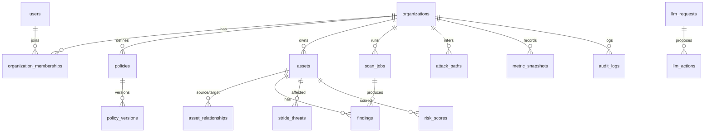

# Database schema

SQLite via SQLAlchemy. 24 tables; every org-scoped table carries `organization_id`
indexed, plus indexes on severity/risk/status/time columns.

## Identity & tenancy

- **users** — username (unique), email, password_hash (werkzeug), is_platform_admin,
  is_active_user, last_login_at.
- **organizations** — name (unique), description.
- **organization_memberships** — user ↔ organization with org role
  (`admin | author | analyst`) + `extra_permissions` (JSON list of extra ACL grants).
  Extra grants are limited to organization-scoped permissions; platform namespaces are
  never delegated through membership JSON. Unique (user, organization).

Historical user attribution is intentionally nullable in `audit_logs.user_id`,
`llm_requests.user_id`, `policy_versions.author_id`, and `scan_jobs.created_by_id`.
When a Platform Administrator deletes a user, these references are set to NULL while
`audit_logs.username` and audit details remain, preserving historical accountability.
Membership rows cascade with the user. Self-deletion and deletion/demotion of the last
active platform administrator are blocked.

## Policy

- **policies** — one per organization (logical), points at current published version.
- **policy_versions** — version number, raw markdown `content`, `parsed` JSON document,
  `parse_errors`, status (`draft|validated|published|archived`), author, published_at.
  Unique (policy, version).

## Asset graph

- **assets** — one typed table: `asset_type`
  (`domain|subdomain|ip|cidr|port|service|webapp|endpoint|technology|certificate|api`),
  name (unique per type+org), hostname, ip_address, port, scheme, criticality,
  environment, exposure (`internet|restricted|internal`), is_production, status
  (`active|removed|unmanaged`), owner, notes, `details` JSON (DNS records, service
  version, cert data, webapp metadata), `risk_score` (0–100 denormalized from the latest
  RiskScore), first/last seen.
- **asset_relationships** — directed typed edges: `resolves_to`, `hosts`, `runs`,
  `has_technology`, `has_endpoint`, `uses_certificate`, `connectsto`, `part_of`.
  Unique (source, target, kind).
- **asset_tags** — free-form tags, unique (asset, tag).
- **trust_boundaries** / **trust_boundary_members** — named boundaries with assets on
  `outside`/`inside` sides; used by the STRIDE engine for cross-boundary analysis.

## Scanning

- **scan_jobs** — tool, operation, targets JSON, parameters JSON, status lifecycle,
  validation trail JSON (policy/ACL decisions), safe command metadata (argv array),
  tool_version, result_summary JSON, error, timestamps, source
  (`manual|llm|monitor|demo`).
- **tool_records** — cached availability/version per external tool.

## Findings

- **findings** — normalized vulnerability records: source, template_id, title, severity
  (`info|low|medium|high|critical`), cvss, cve, description, evidence, remediation,
  **dedup_key** (e.g. `cve:CVE-2021-44228`) that correlates the same issue across tools,
  status (`open|in_progress|resolved|risk_accepted|false_positive`), first/last seen,
  resolved_at. Unique grouping (org, asset, dedup_key, status=open).

## Threat modeling

- **stride_threats** — category_code (S/T/R/I/D/E), title, description, evidence JSON,
  severity, confidence, status, mitigation, engine rule key, `fingerprint`
  (deterministic id so re-runs update in place).

## Risk & paths

- **risk_scores** — per-asset score + full `factors` JSON breakdown (components, weights)
  + explanation text; every recalculation appends a new row (history).
- **attack_paths** — entry/target asset, ordered `steps` JSON, risk score 0–100,
  path_type (`potential|high_value`).
- **org_risk_snapshots** — org-level score over time for trends.

## Metrics

- **metric_snapshots** — kind (`kpi|kri|org_risk`), key, value, unit, recorded_at.

## Monitoring

- **schedules** — org monitoring cycles: interval, operations, tools, enabled,
  last/next run.
- **change_events** — change_type (`new_asset`, `new_port`, `closed_port`,
  `changed_service`, `new_finding`, `resolved_finding`, …), old/new value JSON,
  detected_at.
- **alerts** — severity, title, message, type, acknowledged.

## Audit & LLM

- **audit_logs** — timestamp, user (+ denormalized username), organization, action,
  resource + id, result (`ok|denied|error`), reason, request_id, IP, details JSON.
  Never contains secrets.
- **llm_requests** — user message, intent, response text, proposed actions JSON,
  validation summary, status.
- **llm_actions** — per-action structured request JSON, backend decision
  (`pending|allowed|denied`), decision reason, validation JSON, execution status,
  linked scan job.

## ERD (simplified)

